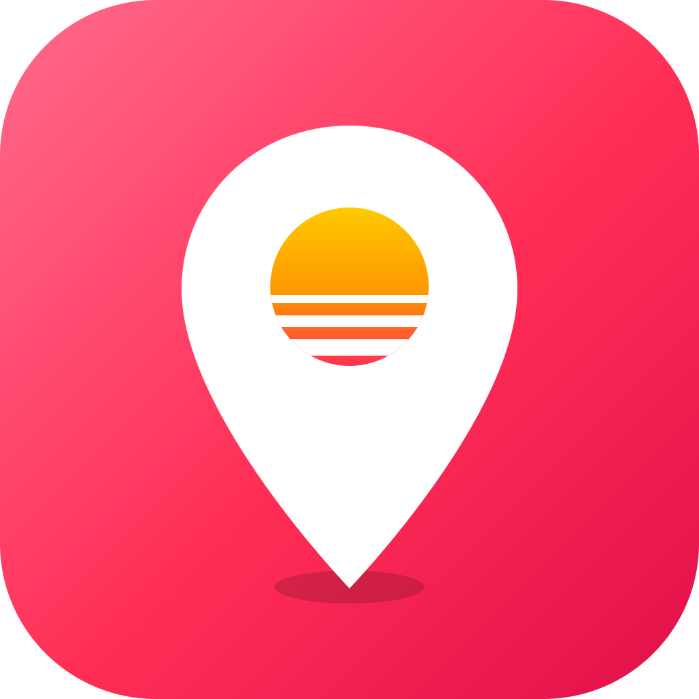
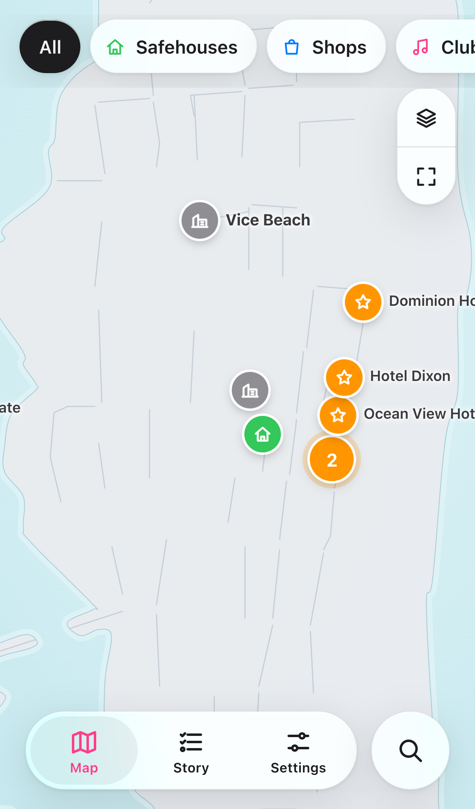
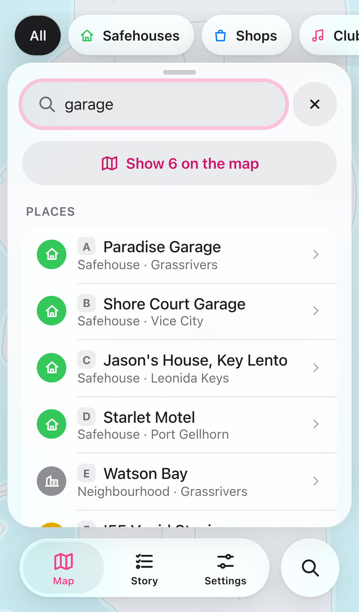
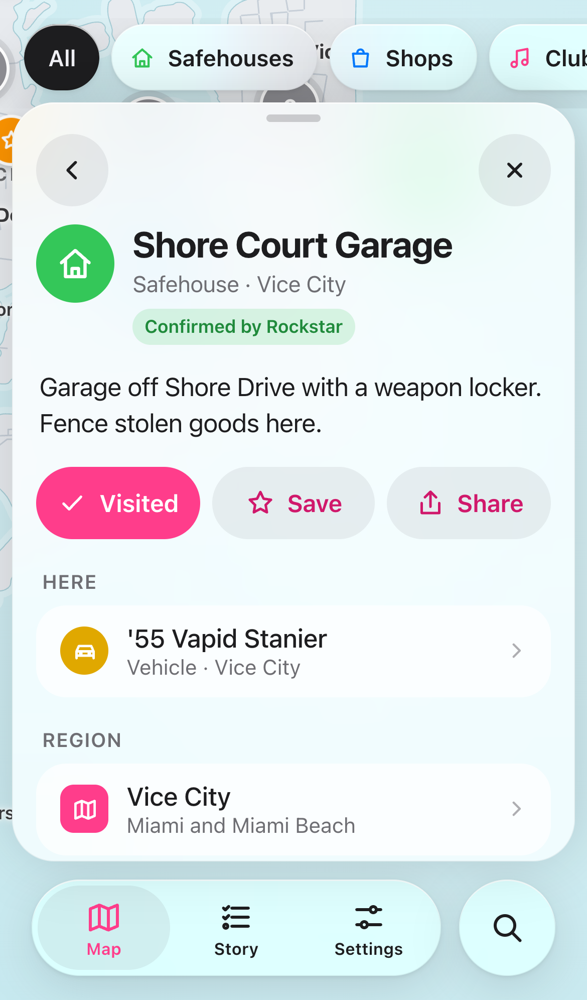
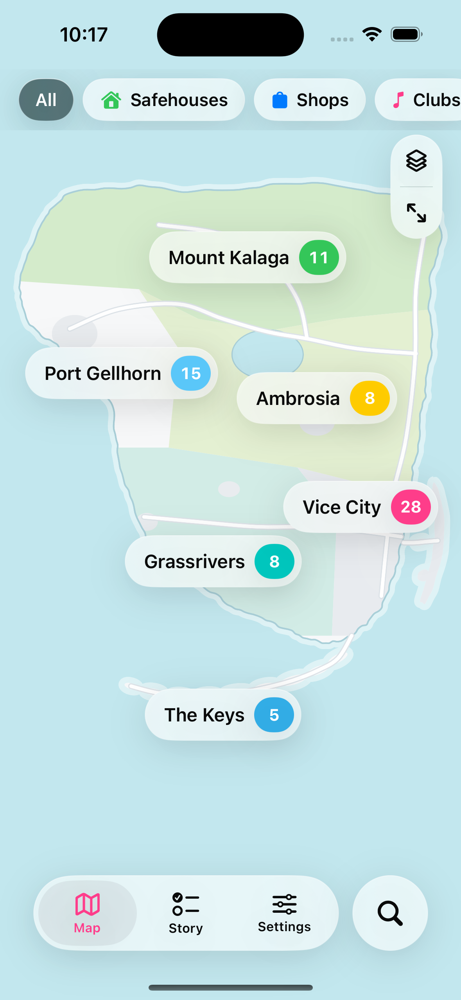
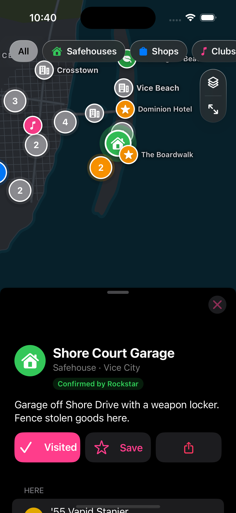
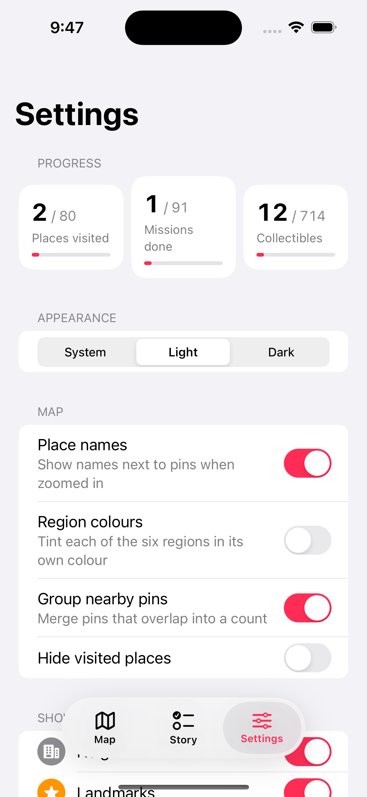

<p align="center"></p>
<h1 align="center">Flamingo</h1>
<p align="center"><b>Every pin in Leonida.</b></p>
<p align="center">
<a href="https://flamingo.jaybulb.com"></a>


</p>

The unofficial map for GTA VI. Every named place in Leonida, all 91 story missions and the collectible sets, on one searchable map.

<p align="center">  </p>

## What's in it
- **The map.** Six regions, from the Keys up to Mount Kalaga. Zoomed out, each region gets one card. Zoom in and the pins split out, with names.
- **Search.** One field for places, regions, missions and collectibles. When it's empty, you can browse by category.
- **Places.** 87 places have pins. Each shows its category, its region and how sure we are: confirmed by Rockstar, seen in footage, or a fan theory.
- **Progress.** Mark places visited and missions done, and count collectibles. It all stays on your device.
- **No spoilers.** Mission and chapter names stay hidden until you turn them on.
- **Settings.** Choose light, dark or system appearance, place names, region colours, pin grouping, and which categories show.

## iPhone and iPad
`apple/` is a SwiftUI app that reads the same `leonida.json`. It has the same map, region cards, clusters, search and settings, with a floating glass dock: Liquid Glass on iOS 26, materials on iOS 17 and 18.

<p align="center">  </p>

```
cd apple && xcodegen && xcodebuild -scheme Flamingo -destination 'generic/platform=iOS Simulator' CODE_SIGNING_ALLOWED=NO PRODUCT_NAME=Flamingo build
sh scripts/ios-shots.sh <booted-simulator-udid>   # 10 QA screenshots, light and dark
```

## Run
```
python3 -m http.server 8790 -d web     # then open http://localhost:8790/app/
node scripts/build-data.mjs            # rebuild web/data/leonida.json from the source list
```

## Test
```
node --test tests/search.test.mjs      # search ranking and data integrity
node tests/qa.mjs                      # headless Chrome: 28 checks, phone and desktop, light and dark; saves screenshots
node tests/landing.mjs                 # landing page at phone and desktop sizes
```

## Data
Place names come from Rockstar's trailers and official site, cross-checked against the community maps (gtamapped.com, timesaver.gg, gtaside.com). Rockstar hasn't published a map, so the geography is drawn by hand and pins are approximate. Found a wrong pin? Email [info@jaybulb.com](mailto:info@jaybulb.com?subject=Flamingo).

## Map data
The coastline, lakes and region borders are traced from the GTADB map tiles, and many pin positions come from the GTADB landmarks: "GTA VI Map Tiles and Landmarks Data (CC BY 4.0) — https://map.gtadb.org". `scripts/trace-coast.py` does the tracing (changes made: traced, simplified, regrouped into six regions).

## Not affiliated
Unofficial fan project. Not affiliated with or endorsed by Rockstar Games or Take-Two Interactive. Grand Theft Auto is a trademark of Take-Two Interactive.

## License
Apache 2.0. The Inter font is under the OFL.
